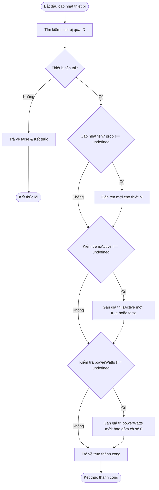

# BÁO CÁO PHÂN TÍCH VÀ SỬA LỖI CẠM BẪY FALSY TRONG JAVASCRIPT KHI CẬP NHẬT TRẠNG THÁI THIẾT BỊ

> 👤 **Học viên:** Hoàng Công Dũng | **Mã SV:** PTIT-HCM-009
> 🏫 **Môn học:** it103b-rl-HoangCongDung

---

## 📊 Sơ đồ thiết kế hệ thống (Flowchart)

> 💡 *Sơ đồ dưới đây được render tự động trực tiếp trên GitHub bằng Mermaid. Bạn cũng có thể tải file **`bt1.drawio`** trong repository này để mở và chỉnh sửa trực tiếp trên [Draw.io (diagrams.net)](https://app.diagrams.net).* 

---

## 1. Mục tiêu và Bối cảnh bài toán

Trong quá trình phát triển ứng dụng Smart Home bằng JavaScript, việc cập nhật trạng thái thiết bị là một thao tác diễn ra liên tục. Tuy nhiên, nếu kiểm tra điều kiện cập nhật bằng cú pháp truthiness thông thường ('if (prop)') thay vì kiểm tra sự tồn tại tường minh ('prop !== undefined'), lập trình viên sẽ rơi vào cạm bẫy Falsy Value.

Đề bài đặt ra yêu cầu xử lý hai trường hợp nghiệp vụ cụ thể: tắt điều hòa phòng khách với giá trị trạng thái là 'isActive: false' và hạ công suất đèn ngủ về mức 0W với giá trị 'powerWatts: 0'. Cả hai giá trị này trong JavaScript đều trả về false khi ép kiểu boolean, khiến hàm cập nhật nguyên bản bỏ qua hoàn toàn.

- Phát hiện và phân tích nguyên nhân kỹ thuật của lỗi Falsy trong JavaScript.
- Xây dựng bảng Test Cases đối chứng để chứng minh sự khác biệt giữa kết quả sai thực tế và kết quả đúng mong đợi.
- Hoàn thiện hàm cập nhật thiết bị trong tệp 'solution_ex1.js' với cơ chế kiểm tra '!== undefined'.

## 2. Phân tích lỗi sai AS-IS và Quy tắc nghiệp vụ

Xét đoạn mã nguồn hiện tại của hàm 'updateDevice', các câu lệnh kiểm tra sử dụng cấu trúc 'if (updatedData.isActive)' và 'if (updatedData.powerWatts)'. Khi 'updatedData.isActive = false', biểu thức trong ngoặc nhận giá trị falsy và bị bỏ qua. Tương tự, khi 'updatedData.powerWatts = 0', số 0 cũng bị đánh giá là falsy, làm cho lệnh cập nhật công suất đèn ngủ không thực thi.

Để khắc phục triệt để tình trạng này, chúng ta phải thay đổi cách kiểm tra điều kiện sang so sánh tường minh với 'undefined'. Cách làm này đảm bảo rằng các giá trị có ý nghĩa nghiệp vụ như 'false' hoặc '0' vẫn được ghi nhận và cập nhật chính xác vào hệ thống.

- Nguyên nhân cốt lõi: JavaScript coi '0', 'false', 'null', 'undefined', 'NaN', và chuỗi rỗng '' là các giá trị Falsy.
- Giải pháp kỹ thuật: Sử dụng toán tử nghiêm ngặt 'updatedData.prop !== undefined' để phân biệt rõ ràng giữa việc thuộc tính không được truyền ('undefined') với việc thuộc tính mang giá trị Falsy hợp lệ.
- Đảm bảo an toàn dữ liệu và tuân thủ đúng yêu cầu nghiệp vụ Smart Home.

## 3. Bảng Test Cases đối chứng

Dưới đây là bảng 02 Test Cases đối chứng thể hiện sự khác biệt rõ rệt giữa hàm cũ (AS-IS) và hàm sau khi đã sửa lỗi (TO-BE):

| Trường hợp kiểm thử | Dữ liệu đầu vào ('updatedData') | Kết quả sai thực tế (Mã cũ) | Kết quả đúng mong đợi (Mã mới) |
| --- | --- | --- | --- |
| TC1: Tắt điều hòa | { isActive: false } | Trạng thái 'isActive' của điều hòa giữ nguyên giá trị cũ, không chuyển sang false. | Trạng thái 'isActive' được cập nhật chính xác thành 'false'. |
| TC2: Hạ công suất đèn về 0W | { powerWatts: 0 } | Thuộc tính 'powerWatts' của đèn giữ nguyên giá trị cũ, không hạ xuống 0. | Thuộc tính 'powerWatts' được cập nhật chính xác thành '0'. |

## 4. Đánh giá sơ đồ thiết kế và Ghi chú cơ chế Falsy

Sơ đồ Activity Diagram được thiết kế để minh họa toàn bộ luồng xử lý của hàm 'updateDevice' sau khi cải tiến. Các điểm rẽ nhánh ('Decision') được áp dụng để kiểm tra từng thuộc tính một cách độc lập.

Cơ chế Falsy trong JavaScript yêu cầu lập trình viên phải hết sức cẩn trọng khi làm việc với các giá trị số 0 hoặc boolean false trong các biểu thức điều kiện. Thay vì viết 'if (value)', tiêu chuẩn chuyên nghiệp là sử dụng 'if (value !== undefined)' hoặc 'if (value !== null && value !== undefined)'.

---

## 📁 Danh sách tệp tin nộp bài trong Repository
- 📝 `bt1.docx`: Báo cáo tài liệu phân tích nghiệp vụ hoàn chỉnh.
- 🎨 `bt1.drawio`: File thiết kế sơ đồ chuẩn theo quy định đề bài (mở trực tiếp bằng [Draw.io](https://app.diagrams.net) hoặc Lucidchart).
- 💻 `solution_ex1.js`: Mã nguồn chương trình.
